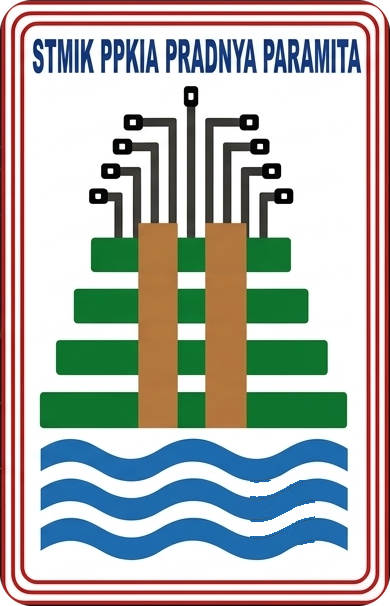

# SIM-KERMA (Sistem Informasi Manajemen Kerjasama)
### STMIK PPKIA Pradnya Paramita Malang

<p align="center">
    
</p>

<p align="center">
    <strong>Platform Terintegrasi Pengelolaan Siklus Hidup Dokumen Kerjasama (MoU, MoA, IA)</strong>
</p>

---

## 📌 Tentang SIM-KERMA

**SIM-KERMA** adalah platform berbasis web yang dirancang khusus untuk mengelola seluruh siklus hidup dokumen kerjasama institusi—mulai dari tahap penyusunan draf, review kolaboratif, penandatanganan dan pembubuhan stempel digital, pelacakan proses (*tracking*), hingga pelaporan statistik dan pengawasan masa berlaku dokumen secara terotomatisasi.

---

## 🚀 Fitur Utama

- **Dashboard Analitik**: Visualisasi statistik dokumen aktif, draf, kedaluwarsa, serta grafik interaktif *Top Mitra Kerjasama*.
- **Hierarki Dokumen**: Keterhubungan terstruktur antara *Memorandum of Understanding* (MoU), *Memorandum of Agreement* (MoA), dan *Implementation Arrangement* (IA).
- **Editor Dokumen**: Integrasi editor TinyMCE dengan kemampuan import file Word (`.docx`).
- **High-Fidelity PDF Engine**: Integrasi Gotenberg (LibreOffice Engine) untuk konversi dokumen Word ke PDF dengan tata letak presisi A4.
- **E-Signature & Stempel Digital**: Pengunggahan dan penempatan tanda tangan serta stempel digital dengan optimasi ukuran gambar otomatis.
- **Master Data**: Pengelolaan data referensi mitra (Pemerintah, Perguruan Tinggi, Perusahaan, Lainnya) dan unit kerja pengusul institusi.
- **Role-Based Access Control (RBAC)**: Pembagian hak akses terperinci untuk *Super Admin*, *Unit Pengusul*, dan *Mitra/Client*.
- **Monitoring Masa Berlaku**: Notifikasi otomatis sistem sebelum masa berlaku dokumen berakhir.
- **Ekspor Laporan**: Fasilitas ekspor data laporan rekapitulasi ke format Excel (`.xlsx`) dan PDF.

---

## 🖥️ Prasyarat Server (System Requirements)

Sebelum memulai instalasi ke lingkungan *production*, pastikan server memenuhi spesifikasi berikut:

### 1. Kebutuhan Perangkat Lunak (Software)
- **Web Server**: Nginx (direkomendasikan) atau Apache 2.4
- **Bahasa Pemrograman**: PHP >= 8.3 (dengan ekstensi: `pdo_mysql`, `mbstring`, `exif`, `pcntl`, `bcmath`, `gd`, `zip`, `xml`, `curl`, `intl`)
- **Database Engine**: MySQL >= 8.0 atau MariaDB >= 10.11
- **Package Manager**: Composer >= 2.6 dan Node.js >= 20.x (NPM >= 10.x)
- **Document Engine**: Gotenberg 8 (berjalan via Docker pada port `3000`)
- **Keamanan**: SSL Certificate (Let's Encrypt / Certbot)

---

## 🛠️ PANDUAN DEPLOYMENT PRODUCTION

Pilih salah satu metode deployment di bawah ini:
1. [Metode 1: Standar (Bare-Metal / VPS Tanpa Docker)](#metode-1-standar-vps--bare-metal-tanpa-docker) *(Direkomendasikan jika server sudah memiliki Nginx & PHP)*
2. [Metode 2: Menggunakan Docker & Docker Compose](#metode-2-menggunakan-docker--docker-compose) *(Direkomendasikan untuk isolasi container dan setup cepat)*

---

### METODE 1: Standar (VPS / Bare-Metal Tanpa Docker)

#### Langkah 1: Update Server dan Pasang Dependensi
Jalankan perintah berikut pada server Linux (contoh: Ubuntu/Debian):
```bash
sudo apt update && sudo apt upgrade -y
sudo apt install -y software-properties-common curl git unzip zip nginx

# Tambahkan repositori PHP Ondrej
sudo add-apt-repository ppa:ondrej/php -y
sudo apt update

# Instal PHP 8.3 dan ekstensi yang dibutuhkan
sudo apt install -y php8.3-fpm php8.3-cli php8.3-mysql php8.3-mbstring \
    php8.3-xml php8.3-bcmath php8.3-curl php8.3-gd php8.3-zip \
    php8.3-intl php8.3-opcache
```

#### Langkah 2: Instal Composer dan Node.js
```bash
# Instal Composer 2
curl -sS https://getcomposer.org/installer | php
sudo mv composer.phar /usr/local/bin/composer

# Instal Node.js 20.x LTS
curl -fsSL https://deb.nodesource.com/setup_20.x | sudo -E bash -
sudo apt install -y nodejs
```

#### Langkah 3: Konfigurasi Database MySQL
Masuk ke terminal MySQL:
```bash
sudo mysql -u root -p
```
Buat database dan pengguna khusus untuk aplikasi:
```sql
CREATE DATABASE sim_kerjasama CHARACTER SET utf8mb4 COLLATE utf8mb4_unicode_ci;
CREATE USER 'simkerma_user'@'localhost' IDENTIFIED BY 'PASSWORD_DATABASE_KUAT';
GRANT ALL PRIVILEGES ON sim_kerjasama.* TO 'simkerma_user'@'localhost';
FLUSH PRIVILEGES;
EXIT;
```

#### Langkah 4: Clone Repositori dan Atur File `.env`
Tempatkan aplikasi di direktori web server (misal `/var/www/sim-kerjasama`):
```bash
cd /var/www
sudo git clone https://github.com/kerubims/sim-kerjasama.git
cd sim-kerjasama

# Salin konfigurasi environment
sudo cp .env.example .env
```
Buka file `.env` menggunakan teks editor (`sudo nano .env`), lalu sesuaikan parameter berikut:
```env
APP_NAME=SIM-KERMA
APP_ENV=production
APP_DEBUG=false
APP_URL=https://simkerma.domain-kampus.ac.id

DB_CONNECTION=mysql
DB_HOST=127.0.0.1
DB_PORT=3306
DB_DATABASE=sim_kerjasama
DB_USERNAME=simkerma_user
DB_PASSWORD=PASSWORD_DATABASE_KUAT

GOTENBERG_URL=http://127.0.0.1:3000
QUEUE_CONNECTION=database
SESSION_DRIVER=database
```

#### Langkah 5: Instal Dependensi dan Build Aset Frontend
```bash
# Instal dependensi backend (tanpa dev package)
composer install --no-dev --optimize-autoloader

# Instal dan build dependensi frontend (Vite)
npm ci
npm run build
```

#### Langkah 6: Generate Key, Storage Link & Migrasi Database
```bash
# Generate encryption key
php artisan key:generate --force

# Buat symbolic link storage public
php artisan storage:link

# Jalankan migrasi dan seeder awal
php artisan migrate --force --seed
```

#### Langkah 7: Optimasi Cache Laravel
Untuk performa maksimal di lingkungan produksi:
```bash
php artisan config:cache
php artisan route:cache
php artisan view:cache
php artisan event:cache
```

#### Langkah 8: Pengaturan Hak Akses (Permissions)
Berikan kepemilikan direktori kepada user web server (`www-data`):
```bash
sudo chown -R www-data:www-data /var/www/sim-kerjasama
sudo chmod -R 755 /var/www/sim-kerjasama
sudo chmod -R 775 /var/www/sim-kerjasama/storage /var/www/sim-kerjasama/bootstrap/cache
```

#### Langkah 9: Konfigurasi Virtual Host Nginx
Buat file konfigurasi Nginx baru:
```bash
sudo nano /etc/nginx/sites-available/sim-kerjasama
```
Masukkan konfigurasi berikut (sesuaikan `server_name` dan path PHP-FPM):
```nginx
server {
    listen 80;
    server_name simkerma.domain-kampus.ac.id;
    root /var/www/sim-kerjasama/public;

    index index.php index.html;
    charset utf-8;

    client_max_body_size 50M;

    location / {
        try_files $uri $uri/ /index.php?$query_string;
    }

    location = /favicon.ico { access_log off; log_not_found off; }
    location = /robots.txt  { access_log off; log_not_found off; }

    error_page 404 /index.php;

    location ~ \.php$ {
        fastcgi_pass unix:/var/run/php/php8.3-fpm.sock;
        fastcgi_param SCRIPT_FILENAME $realpath_root$fastcgi_script_name;
        include fastcgi_params;
        fastcgi_hide_header X-Powered-By;
        fastcgi_read_timeout 300;
    }

    location ~ /\.(?!well-known).* {
        deny all;
    }
}
```
Aktifkan konfigurasi dan restart Nginx:
```bash
sudo ln -s /etc/nginx/sites-available/sim-kerjasama /etc/nginx/sites-enabled/
sudo nginx -t
sudo systemctl reload nginx
```

#### Langkah 10: Pasang SSL (HTTPS) dengan Certbot
```bash
sudo apt install -y certbot python3-certbot-nginx
sudo certbot --nginx -d simkerma.domain-kampus.ac.id
```

#### Langkah 11: Setup Cron Job (Laravel Scheduler)
Cron job wajib diaktifkan agar pengecekan otomatis dokumen kedaluwarsa dan peringatan masa tenggang 30 hari (`documents:check-expiry`) dapat berjalan setiap hari.

Jalankan editor crontab untuk user `www-data`:
```bash
sudo crontab -u www-data -e
```
Tambahkan baris berikut di akhir file:
```cron
* * * * * cd /var/www/sim-kerjasama && php artisan schedule:run >> /dev/null 2>&1
```

#### Langkah 12: Menjalankan Gotenberg Server (Document Engine)
Layanan Gotenberg digunakan untuk konversi file Word (.docx) ke PDF. Jalankan service Gotenberg via Docker:
```bash
sudo apt install -y docker.io
sudo systemctl enable --now docker
sudo docker run -d --restart always --name gotenberg -p 127.0.0.1:3000:3000 gotenberg/gotenberg:8
```

---

### METODE 2: Menggunakan Docker & Docker Compose

Metode ini mengemas seluruh komponen aplikasi (*App*, *Web Server Nginx*, *MySQL 8.0*, dan *Gotenberg*) ke dalam container terisolasi.

#### Arsitektur Container
- **`app`**: PHP 8.3-FPM dengan ekstensi lengkap dan source code aplikasi.
- **`webserver`**: Nginx Alpine sebagai reverse proxy ke aplikasi pada port `80`/`443`.
- **`db`**: MySQL 8.0 dengan volume persisten data.
- **`gotenberg`**: Gotenberg 8 API untuk konversi dokumen.

#### Langkah 1: Persiapan Server
Pastikan Docker dan Docker Compose telah terpasang:
```bash
sudo apt update
sudo apt install -y curl git
curl -fsSL https://get.docker.com | sh
sudo usermod -aG docker $USER
```

#### Langkah 2: Clone Repositori
```bash
git clone https://github.com/kerubims/sim-kerjasama.git
cd sim-kerjasama
```

#### Langkah 3: Konfigurasi Environment `.env`
Salin template environment:
```bash
cp .env.example .env
```
Sesuaikan variabel environment untuk Docker pada file `.env`:
```env
APP_NAME=SIM-KERMA
APP_ENV=production
APP_DEBUG=false
APP_URL=https://simkerma.domain-kampus.ac.id
APP_PORT=80

DB_CONNECTION=mysql
DB_HOST=db
DB_PORT=3306
DB_DATABASE=sim_kerjasama
DB_USERNAME=simkerma_user
DB_PASSWORD=PASSWORD_DATABASE_KUAT
DB_ROOT_PASSWORD=ROOT_PASSWORD_KUAT

GOTENBERG_URL=http://gotenberg:3000
QUEUE_CONNECTION=database
SESSION_DRIVER=database
```

#### Langkah 4: Build dan Jalankan Container
Jalankan stack container di latar belakang:
```bash
docker compose up -d --build
```
Periksa status seluruh container:
```bash
docker compose ps
```
Pastikan seluruh service (`app`, `webserver`, `db`, `gotenberg`) berstatus *Up* / *healthy*.

#### Langkah 5: Inisialisasi Aplikasi dalam Container
Jalankan perintah inisialisasi Laravel melalui container `app`:
```bash
# Generate encryption key
docker compose exec app php artisan key:generate --force

# Buat symbolic link storage
docker compose exec app php artisan storage:link

# Migrasi dan seeding database
docker compose exec app php artisan migrate --force --seed

# Optimasi cache konfigurasi
docker compose exec app php artisan optimize
```

#### Langkah 6: Konfigurasi SSL untuk Docker
Jika server host menggunakan Nginx utama sebagai reverse proxy publik dengan SSL:
```nginx
server {
    listen 80;
    server_name simkerma.domain-kampus.ac.id;
    return 301 https://$host$request_uri;
}

server {
    listen 443 ssl http2;
    server_name simkerma.domain-kampus.ac.id;

    ssl_certificate /etc/letsencrypt/live/simkerma.domain-kampus.ac.id/fullchain.pem;
    ssl_certificate_key /etc/letsencrypt/live/simkerma.domain-kampus.ac.id/privkey.pem;

    client_max_body_size 50M;

    location / {
        proxy_pass http://127.0.0.1:80;
        proxy_set_header Host $host;
        proxy_set_header X-Real-IP $remote_addr;
        proxy_set_header X-Forwarded-For $proxy_add_x_forwarded_for;
        proxy_set_header X-Forwarded-Proto https;
    }
}
```

---

## 🔐 Akun Bawaan Sistem (Default Credentials)

Setelah menjalankan seeder (`--seed`), akun bawaan berikut siap digunakan untuk verifikasi login:

| Role / Hak Akses | Email Akun | Password Default | Akses Menu |
|---|---|---|---|
| **Super Admin** | `admin@univ.ac.id` | `password` | Seluruh Modul (Dokumen, Tracking, Laporan, Master Data, Manajemen Pengguna) |
| **Unit Pengusul** | `unit_ti@univ.ac.id` | `password` | Draf Dokumen, Review, dan Penandatanganan Internal |
| **Mitra (Client)** | `pt_tech@mitra.com` | `password` | Review Dokumen Kerjasama & Pembubuhan Tanda Tangan/Stempel |
| **Mitra Alternatif** | `pt_rsj@mitra.com` | `password` | Review Dokumen Kerjasama & Pembubuhan Tanda Tangan/Stempel |

> [!WARNING]
> Segera ganti password seluruh akun bawaan di atas melalui menu manajemen profil pengguna setelah instalasi di server produksi selesai!

---

## 🔄 Pemeliharaan & Prosedur Update (Maintenance)

Ketika ada pembaruan kode di branch `main`, lakukan langkah update berikut:

### Jika Menggunakan Bare-Metal (Metode 1):
```bash
cd /var/www/sim-kerjasama
php artisan down # Aktifkan maintenance mode

git pull origin main
composer install --no-dev --optimize-autoloader
npm ci && npm run build
php artisan migrate --force
php artisan optimize:clear
php artisan optimize

php artisan up # Matikan maintenance mode
```

### Jika Menggunakan Docker (Metode 2):
```bash
cd /path/to/sim-kerjasama
git pull origin main
docker compose build app
docker compose up -d
docker compose exec app php artisan migrate --force
docker compose exec app php artisan optimize:clear
docker compose exec app php artisan optimize
```

---

## 🛠️ Tech Stack

- **Framework Backend**: Laravel 13 (PHP 8.3+)
- **Frontend Engine**: Blade Templates, Tailwind CSS, Alpine.js, Vite
- **Database Engine**: MySQL 8.0 / MariaDB
- **Document Engine**: Gotenberg 8 (LibreOffice Engine) & Mammoth.js
- **Media & Image Optimization**: Intervention Image
- **Export Utility**: Laravel Excel (Maatwebsite) & DomPDF / FPDI

---

## 📄 Lisensi

Aplikasi ini dikembangkan untuk kebutuhan internal institusi di bawah lisensi [MIT](LICENSE).
